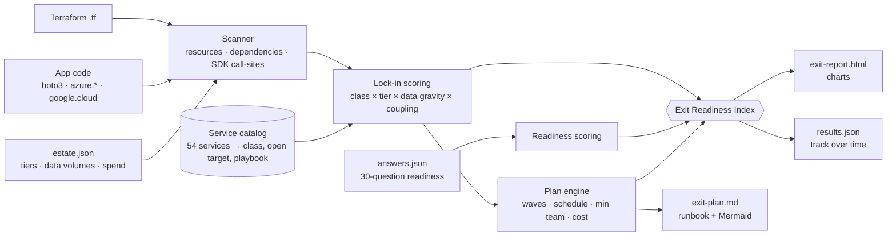
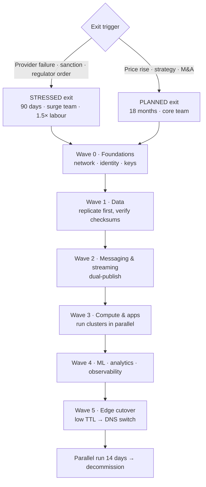
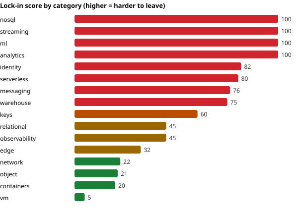
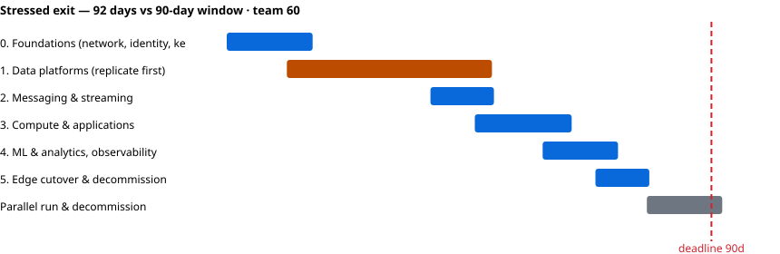

# 🚪 exit-ready

**Cloud exit strategy and portability assessment framework.**
Point it at your Terraform and application code. It tells you — with numbers an executive and a regulator can both read —
*how locked in you are, what it would cost and how long it would take to leave, whether you could do it under stress,
and exactly which runbook steps to take, in what order.*

Built for CIOs, CROs, CTOs and boards of banks, government agencies, parastatals and Fortune-class enterprises who must
show a **credible, tested exit plan** (DORA Art. 28(8), PRA SS2/21 stressed exit, EBA outsourcing guidelines, US third-party
risk guidance — see [`docs/regulatory-crosswalk.md`](docs/regulatory-crosswalk.md)).

> Zero dependencies. Python 3.10+. Two fictional sample estates included so you can see a RED and a GREEN result in 2 seconds.

```bash
git clone <this-repo> && cd exit-ready
python -m unittest discover -s tests -t .     # 21 tests
python -m exitkit demo                         # scans both samples, writes out/*/exit-report.html + exit-plan.md
python -m exitkit assess path/to/your/repo --out out   # your own estate
```

## The four questions it answers

| Board question | Answer produced |
|---|---|
| How locked in are we? | Lock-in score 0–100, by category and by resource, with the open-standard target for each hotspot |
| What would leaving cost? | Egress + labour + dual-running + contingency, as USD and **% of annual cloud spend** |
| Could we leave if we *had* to? | Stressed (90-day) and planned (18-month) scenarios: **FEASIBLE / NOT FEASIBLE**, and the minimum team size that would make it so |
| Are we organisationally ready? | 30-question readiness assessment across 5 domains, with **critical gaps** (gate questions) called out |

## How it works





## Real output (from `python -m exitkit demo`)

```
Northwind Bank — Payments Platform: 32 resources, aws, $136,120/month
  ERI 25 [RED]   lock-in 61 (HIGH)   readiness 11% (Initial)
  stressed    92d vs  90d window  NOT FEASIBLE (needs team 65)       cost $ 5,385,044  (329.7% of annual spend)
  planned    225d vs 540d window  FEASIBLE                           cost $ 3,633,885  (222.5% of annual spend)

Fabrikam Regional Gov Portal: 10 resources, aws, $16,750/month
  ERI 80 [GREEN]   lock-in 22 (LOW)   readiness 82% (Tested)
  stressed     53d vs  90d window  FEASIBLE                           cost $   139,544  (69.4% of annual spend)
  planned      94d vs 540d window  FEASIBLE                           cost $   103,143  (51.3% of annual spend)
```

**Northwind (locked in):** DynamoDB ledger, Kinesis, Step Functions, Cognito, SageMaker and Lambda sit in the critical path.

| | |
|---|---|
|  |  |




**Fabrikam (portable):** same cloud, but Postgres, Kubernetes, Kafka and S3-API storage. Leaving is a project, not a crisis.


The generated [`exit-plan.md`](#) contains a Mermaid wave diagram with real dependency edges and a per-resource runbook, e.g.:

> **aws_dynamodb_table.ledger** (tier1, class 5) → *ScyllaDB / Cassandra / PostgreSQL JSONB* — "Access patterns are the schema: re-model, dual-write via streams, backfill, verify, cut reads then writes."
> **aws_cognito_user_pool.customers** → *Keycloak / Ory* — "Password hashes cannot be exported: use lazy-migration on first login or forced reset; plan comms."

## What the numbers teach (and what they don't)

- **Egress is rarely the killer.** ~547 TB costs ≈ $49k to move; the money is in labour, dual-running and re-architecture.
- **The deadline gets missed by days, not months** — which is exactly why `min_team` and a tested runbook matter.
- **Class-5 services dominate**: five proprietary services drive most of Northwind's score. That's where to spend de-risking money first.
- It is a **model**. Rates, throughput and effort are defaults you should replace with measured values (DAT-6).

Full method, formulas and limits: [`docs/methodology.md`](docs/methodology.md).

## Use it on your estate

1. Run `python -m exitkit assess ./your-infra-repo`. It reads every `.tf`, scans code for SDK call-sites, and uses tags
   `criticality = tier1|tier2|tier3`, `data_gb`, `monthly_usd` when present.
2. Add an `estate.json` for anything not in Terraform:
   ```json
   {"name": "My Bank", "settings": {"egress_waived": false, "scenarios": {"stressed": {"window_days": 60, "team": 80}}},
    "resources": {"aws_s3_bucket.docs": {"criticality": "tier1", "data_gb": 250000, "monthly_usd": 6000}}}
   ```
3. Answer the questionnaire in `answers.json` (`{"GOV-1": 2, "DAT-1": 0, ...}`; scale 0 none · 1 documented · 2 implemented · 3 tested). Questions: [`exitkit/data/questionnaire.json`](exitkit/data/questionnaire.json).
4. Re-run quarterly; `python -m exitkit compare before/results.json after/results.json` shows the trend. A board metric that moves is a control that works.

`python -m exitkit catalog` lists all 54 mapped services (AWS, Azure, GCP) with their open-standard targets. Edit the catalog to match your standards.

## Repo map

```
exitkit/scanner.py     Terraform + code scanner (brace-aware, dependency edges)
exitkit/catalog.py     service → class / open target / playbook   (data/catalog.json)
exitkit/scoring.py     lock-in score
exitkit/plan.py        waves, schedule, min-team solver, cost model
exitkit/assess.py      30-question readiness + Exit Readiness Index
exitkit/report.py      HTML (inline SVG) + Markdown/Mermaid exit plan
examples/              northwind-bank (locked in) · portable-estate (open standards)
docs/                  methodology · regulatory crosswalk
tests/                 21 tests incl. XML-validity of every generated chart
```

## Limits (say them before your auditor does)

Click-ops and SaaS dependencies are invisible unless declared · class assignments are opinionated · cost and time are
estimates · the scanner reads Terraform, not Pulumi/CloudFormation/Bicep (parsers welcome) · this is not legal advice.

MIT licensed.
